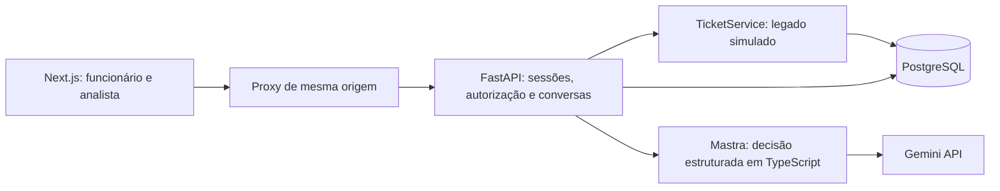

# Nexo Assist

Service desk de TI com chat para funcionários, agente Mastra/Gemini e console para analistas. Next.js na interface, FastAPI nos serviços de negócio e PostgreSQL como fonte de verdade. Execução local com Docker Compose.

> **Decisão de stack:** o PRD pede TypeScript estrito. Por escolha explícita do autor, a API usa Python/FastAPI; isso é uma exceção ao enunciado. Frontend e agente mantêm TypeScript estrito. A justificativa está no [ADR](docs/09-arquitetura-fastapi.md).

## Executar

Pré-requisitos: Docker com Compose e Python 3 para gerar o ambiente local. No Windows:

```powershell
py -3.11 scripts/setup.py
docker compose up -d --build --wait web
```

No Linux/macOS, use `python3 scripts/setup.py`. O script preserva um `.env` existente e gera um segredo interno aleatório no primeiro uso. Alternativamente, copie `.env.example` para `.env` e substitua o segredo indicado manualmente.

- Interface: **http://localhost:3000**.
- API/OpenAPI locais: **http://localhost:8000/docs**.
- Migrations e seed executam antes da API. Reiniciar não apaga dados.
- `docker compose down` encerra os containers preservando o volume.

O modo padrão é **stub**, claramente identificado no chat e nas decisões. Permite testar as jornadas sem chave ou custo. Não existe fallback silencioso de Gemini para stub.

### Gemini real

Configure somente no `.env` local:

```dotenv
LLM_MODE=live
GOOGLE_API_KEY=sua-chave-local
LLM_MODEL=google/gemini-3.8-flash
```

Execute `docker compose up -d --no-deps --force-recreate agent`. A chave é passada apenas ao agente: não entra no frontend, Dockerfile ou Git. O modelo é configurável. Uma chamada real curta foi validada; créditos e preços dependem do projeto/conta do provedor.

### Contas fictícias

Use qualquer senha não vazia. A senha não é armazenada nem enviada ao modelo.

| E-mail | Perfil |
| --- | --- |
| `ana.souza@nexo.com.br` | Funcionária, Financeiro |
| `carla.mendes@nexo.com.br` | Funcionária, Comercial |
| `bruno.tavares@nexo.com.br` | Funcionário |
| `rafael.lima@nexo.com.br` | Analista N2 |
| `luiza.costa@nexo.com.br` | Analista N1 |

## Funcionalidades

- Sessões persistentes e autorização por recurso.
- Chat com histórico, ações durante execução, opções rápidas e limite de 30 turnos por conversa.
- Consulta sem protocolo, seleção e cards com status e SLA.
- Base de 8 artigos com restrições de aplicabilidade, como Windows 10/11.
- Rascunhos revisáveis de criação, complemento e reabertura; confirmação por ID/revisão antes das mutações.
- Busca de chamados semelhantes e confirmação idempotente, inclusive após falha posterior ao commit.
- Transferência com resumo e pausa persistente do agente, inclusive enquanto aguarda analista.
- Console com busca/filtros, histórico, chamados, assunção exclusiva, mensagens, devolução e encerramento.
- Decisões legíveis: intenção, fatos, fontes, regras, segurança estimada e uso/latência quando disponíveis.
- Simulador de falhas e dados preservados após reinício real.

O visual segue o protótipo: identificação com painel escuro, fontes locais Newsreader/Schibsted Grotesk, chat com sidebar e console em colunas. As fontes incluem licenças OFL. Meu perfil reproduz os cartões de dados e senha da referência; o tempo de alteração e a redefinição são apenas ilustrativos, sem envio de e-mail ou alteração de credenciais.

O chat aproveita a largura disponível e usa mensagens maiores. O seletor de atendimentos anteriores fica recolhido; o console mantém acesso às conversas e aos chamados também no celular. Avatares identificam os participantes e a presença online/offline é explicitamente simulada.

## Arquitetura



`apps/web` contém UI/proxy; `apps/api/nexo`, os módulos de negócio; `apps/agent`, Mastra. `ticket_service.py` separa o legado simulado do agente. A API busca dados autorizados e envia contexto limitado ao modelo. Ferramentas Mastra consultam esse contexto de leitura. O modelo não recebe banco nem ferramentas de escrita.

### Decisão, custo e latência

O modelo interpreta linguagem e extrai fatos. Código controla prioridade, SLA, autorização, reabertura e efeitos. Lacunas geram perguntas; pedido humano, criticidade, vencimento ou insegurança geram transferência. Confiança é uma estimativa não calibrada.

Limites: 4 passos de agente, 1.200 tokens de saída, timeout de 35s no modelo e 42s na API, histórico recente limitado, até 30 resumos de chamados e 10 artigos. A demonstração limita 30 turnos por conversa, 10 conversas por funcionário/dia e 300 mensagens de usuário/dia. Mensagens humanas continuam disponíveis ao acabar a cota do agente.

Leituras do legado têm até 3 tentativas no chat, com espera progressiva. Não repetimos automaticamente a chamada ao LLM. Tokens/duração são registrados quando fornecidos. Não calculamos custo monetário sem preço verificado/configurado.

O stream mostra atividade durante a execução e texto em blocos após validar a decisão estruturada. Não é streaming nativo de cada token do provedor.

### Segurança e consistência

Sessão opaca com hash no banco e cookie HttpOnly/SameSite. Mutações verificam origem; consultas de funcionário filtram o dono. Analistas autenticados acessam o contexto do suporte. O agente é privado no Compose e exige segredo interno.

Locks/epoch protegem transições e descartam geração tardia. Confirmação repetida retorna o mesmo resultado. Complementos do funcionário não renovam artificialmente SLA vencido. Encerrar conversa não resolve chamado automaticamente.

O login de senha arbitrária é intencional para os dados fictícios do desafio. Produção exige identidade real; não inserir dados reais nesta demonstração.

### Premissas de SLA

Seg-sex, 08h-18h, America/Fortaleza, sem feriados. Crítica: 1h corrida; alta: 4h úteis; média: 30h úteis; baixa: 50h úteis. Primeira resposta e atualizações substantivas do suporte ancoram o prazo. Bot, usuário e transferência não zeram atraso.

Reabertura até 168h corridas inclusivas, iniciando novo ciclo de primeira resposta. Elevações de prioridade usam a atualização do suporte ou a reabertura mais recente; complementos comuns não renovam esse ciclo. Para vencimento, priorizamos a transferência prevista no Anexo A; o protótipo apresenta oferta opcional. [Premissas e divergências](docs/07-decisoes-e-pendencias.md).

## Testar

Para testes fora do Docker, Node.js 24 e Python 3.11:

```powershell
npm ci
py -3.11 -m venv .venv
.\.venv\Scripts\python.exe -m pip install -r apps/api/requirements.txt
npm run typecheck
npm run format:check
npm run test:agent
.\.venv\Scripts\python.exe -m pytest apps/api/tests -q
npm run build
```

Python usa PostgreSQL real em schemas temporários isolados, sem truncar dados da aplicação. Configure `TEST_DATABASE_URL` se necessário. A migration inicial é congelada e tem teste de upgrade/downgrade em schema vazio.

Para repetir as 19 jornadas sem alterar os atendimentos locais:

```powershell
.\.venv\Scripts\python.exe scripts/test-e2e.py --reset
.\.venv\Scripts\python.exe scripts/verify-persistence.py --isolated
```

O script usa o projeto Docker `nexo-revisao`, portas 3100/8100/55432, banco separado, modo stub e chave vazia. `--reset` recria somente o volume descartável de testes. Requer Compose com suporte a `!override` (2.24.4 ou posterior). Não troque de branch durante a execução. Com outro ambiente limpo em stub, também é possível executar `npm run test:e2e` e configurar `E2E_URL`.

As jornadas cobrem login/perfil/saída, dúvidas, triagem, consulta e seleção, edição/cancelamento/confirmação, duplicidade, complemento, reabertura, transferências, resposta/devolução/encerramento humano, erros e concorrência de navegação. Há verificações em 1920, 1366 e 390 px. Localmente usam Chrome; CI instala Chromium. A API tem 57 testes PostgreSQL e o agente tem 2 testes de contrato.

- `scripts/verify-persistence.py`: reinicia API/agente/web e verifica sessão, mensagens, rascunho e atendimento humano. Tokens ficam apenas em memória.
- `scripts/smoke-live.py`: uma conversa curta; falha se não houver decisão real. Consome a API configurada.
- `scripts/evaluate-live.py`: três cenários reais limitados, de horário, assunto fora de TI e criticidade. Consome créditos do Gemini local e não imprime credenciais.
- `scripts/verify-no-secrets.py`: verifica os segredos locais contra arquivos rastreados e bundle do browser, sem exibir valores.

GitHub Actions executa build/typecheck, testes de agente, lint/formatação Python, integração PostgreSQL e E2E Docker sem chave paga. `main` é protegida; entregas entram por PR após checks.

## Limitações e trabalho futuro

- API Python é a exceção de linguagem escolhida; validar aceitação com o avaliador.
- Duplicidade usa heurística de título/categoria e alvo visível antes da confirmação.
- Sem feriados, SSO, e-mail real, anexos, controle remoto ou integração ITSM externa.
- Turno interrompido fica identificado e mantém contexto; não há retomada automática em background.
- Legado indisponível não impede chat humano; sincronização automática posterior fica como evolução.
- Testes validam cenários específicos. Um smoke real não equivale a benchmark completo do modelo.
- Deploy público é diferencial e não foi feito. O repositório é público; a aplicação escuta em localhost.

## Documentação

[Requisitos](docs/01-requisitos.md) · [Telas](docs/05-telas-e-experiencia.md) · [ADR vigente](docs/09-arquitetura-fastapi.md) · [Backlog e issues](docs/BACKLOG.md) · [Auditoria do PDF e das jornadas](docs/11-auditoria-do-desafio.md).

Documentos 02-07 preservam hipóteses do levantamento inicial; este README e o ADR descrevem a arquitetura implementada. Materiais originais e `.env` ficam locais. O inventário visual sanitizado está em `docs/referencias/inventario-prototipo.json`.
