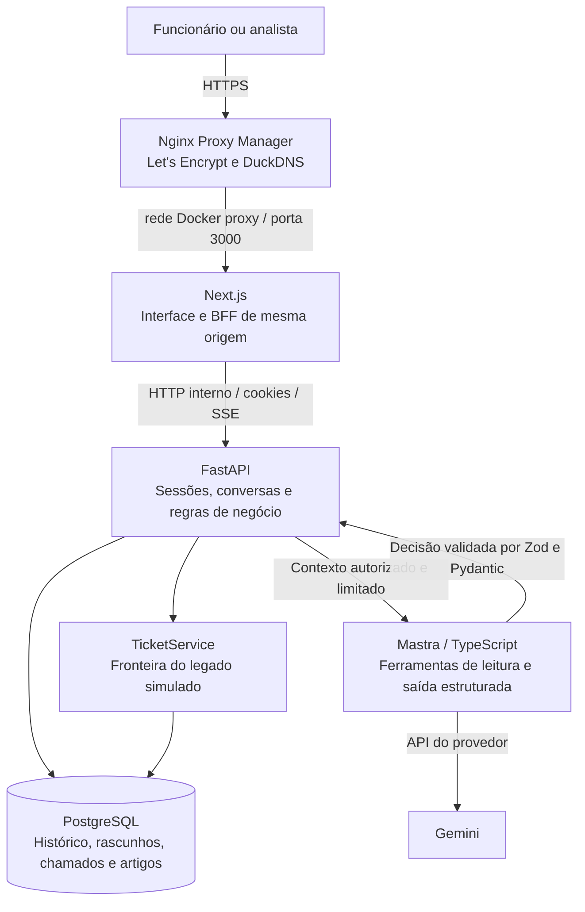

# Nexo Assist

Service desk de TI com um agente que orienta o funcionário, prepara chamados para revisão e entrega o contexto ao suporte humano. O analista acompanha a fila, assume conversas, encaminha entre N1 e N2 e registra a solução sem perder o histórico.

**Demonstração:** [nexoassist.duckdns.org](https://nexoassist.duckdns.org) · **Stack:** Next.js, TypeScript, FastAPI, Mastra, Gemini, PostgreSQL e Docker Compose.

Este projeto foi construído para um desafio técnico. As contas, os chamados iniciais e os artigos são fictícios. O login aceita qualquer senha não vazia, como solicitado no enunciado; não representa autenticação pronta para uso corporativo.

## Como rodar

É necessário Docker com Compose e Python 3. No Windows:

```powershell
py -3.11 scripts/setup.py
docker compose up -d --build --wait web
```

No Linux/macOS, use `python3 scripts/setup.py`. O script cria o `.env` com segredo interno aleatório e preserva configurações existentes. Migrations e seed executam antes da API; reiniciar os serviços preserva os dados.

- Interface: **http://localhost:3000**.
- API e OpenAPI locais: **http://localhost:8000/docs**.
- `docker compose logs -f api agent` acompanha os serviços.
- `docker compose down` encerra os containers sem remover o volume do PostgreSQL.

O padrão local é **stub**: respostas determinísticas para desenvolvimento e testes sem consumir o provedor. A interface informa o modo. Uma falha do modelo real não muda silenciosamente para stub.

### Usar o modelo real

Edite somente o `.env` local:

```dotenv
LLM_MODE=live
GOOGLE_API_KEY=sua-chave
LLM_MODEL=google/gemini-3.8-flash
```

Depois execute `docker compose up -d --no-deps --force-recreate agent`. A chave fica no ambiente do agente, sem entrar no browser, no Git ou nas imagens. O modelo é configurável; disponibilidade, limites e cobrança dependem da conta no provedor.

### Contas de demonstração

Use qualquer senha não vazia. Ela não é armazenada nem enviada ao modelo, pode usar na página principal os shortcuts para preencher email.

| E-mail | Perfil |
| --- | --- |
| `ana.souza@nexo.com.br` | Funcionária do Financeiro |
| `carla.mendes@nexo.com.br` | Funcionária do Comercial |
| `bruno.tavares@nexo.com.br` | Funcionário |
| `luiza.costa@nexo.com.br` | Analista N1 |
| `rafael.lima@nexo.com.br` | Analista N2 |

## Arquitetura e escolhas

Organizei o projeto em um monorepo com três aplicações e um banco persistente. A interpretação da conversa fica no agente; autorização, regras de negócio e alterações de estado ficam na API.



O Nginx e o domínio fazem parte do deploy público. Localmente, o navegador acessa o Next.js diretamente. O `TicketService` é um módulo separado dentro da API, representando a integração com um sistema legado; não é um microserviço independente.

| Componente | Escolha e motivo |
| --- | --- |
| **Next.js / React / TypeScript estrito** — `apps/web` | Já conheço e uso bastante Next.js. Para este projeto, preferi sua camada de servidor e as rotas do App Router para integrar a interface à API, manter cookies na mesma origem e encaminhar o stream. React com Vite também atenderia à interface, mas exigiria organizar essa camada à parte. A [documentação do React recomenda começar aplicações novas com um framework](https://react.dev/learn/creating-a-react-app), incluindo Next.js. |
| **FastAPI / Python / Pydantic** — `apps/api` | Optei por demonstrar conhecimento de outra linguagem e de uma stack frequente em projetos de IA e machine learning. FastAPI oferece contratos tipados, validação e OpenAPI com pouco código adicional. Aqui ele concentra o domínio; não há treinamento de modelos. O enunciado pede TypeScript estrito: usar Python na API é uma divergência consciente, documentada no [ADR](docs/09-arquitetura-fastapi.md). Frontend e agente mantêm TypeScript estrito. |
| **Mastra / Zod / TypeScript** — `apps/agent` | Mastra estrutura o agente, as ferramentas e a geração de decisões. Zod define o contrato recebido pela API. Mantive esse serviço separado para isolar chave, dependências, execução e limites do modelo. Mastra é a biblioteca de orquestração, não o executor dos testes. |
| **PostgreSQL / SQLAlchemy / Alembic** | Escolhi PostgreSQL pela familiaridade, praticidade e eficiência em dados relacionais. Transações, restrições e locks ajudam a manter confirmação, chamado e encaminhamento consistentes. SQLAlchemy organiza a persistência; Alembic versiona o schema. |
| **Docker Compose** | Gerencia os serviços, redes, healthchecks e ordem de inicialização. O mesmo projeto pode ser reproduzido localmente e executado na VM com imagens prontas. Para o tamanho desta entrega, evita a complexidade de um orquestrador maior. |
| **Gemini configurável** | Já tinha créditos disponíveis no Google e aproveitei esse saldo para executar o desafio e as conversas reais. Dentro dessa opção, escolhi a linha Flash para buscar equilíbrio entre latência, uso de tokens e suporte a ferramentas/saída estruturada. A escolha pode ser revista a partir de avaliações; o domínio não depende de um modelo específico. |

O Next.js funciona como **BFF** (Backend for Frontend), encaminhando chamadas para o FastAPI. As regras não ficam duplicadas nas rotas do frontend. A interface usa CSS próprio, `lucide-react` e fontes locais com licença OFL.

### Por que esse modelo e como avaliaria o custo

O motivo inicial para usar Gemini foi simples: eu já tinha créditos lá rs. Isso viabilizou testar o agente de verdade durante o desenvolvimento, sem contratar outro provedor para o desafio. O saldo disponível reduz meu desembolso imediato, mas não torna a inferência gratuita nem demonstra que Gemini é a alternativa mais barata.

O modelo configurado nesta entrega é `google/gemini-3.8-flash`. A linha Flash foi a opção para uma tarefa de triagem com respostas curtas, extração de fatos e uso de ferramentas, buscando uma conversa ágil sem recorrer a um modelo maior em todas as mensagens. Os limites de passos, contexto e saída também controlam o consumo. A mediana de 5,39 s na rodada real é a evidência local de latência; não fiz um benchmark entre provedores.

Se eu começasse um projeto com liberdade de escolha de provedor, minha preferência inicial seria **OpenAI com um modelo terra recente**. Um candidato para avaliação é o [GPT-6.0 luna](https://developers.openai.com/api/docs/models/gpt-6-luna), que oferece function calling, saídas estruturadas e controle do esforço de raciocínio com custo pequeno. Esses recursos permitem testar contratos mais restritos e ajustar o equilíbrio entre tempo de resposta e análise seria bom testes reais para confirmar que ele daria conta. Continuaria validando o resultado e aplicando as regras na API: aderir a um schema não garante que a associação entre dois chamados esteja correta.

O ganho que eu buscaria seria **menor custo por atendimento concluído com qualidade**, boa previsibilidade dos contratos e menos tentativas ou esclarecimentos desnecessários. São objetivos a medir, não melhorias já comprovadas sobre Gemini. Compararia os mesmos roteiros de duplicidade, criticidade, reabertura e N1/N2, observando acerto semântico, falhas de contrato, latência e tokens por conversa. Casos difíceis poderiam justificar um modelo maior, em vez de pagar esse custo em toda interação.

Para estimar gasto, separaria tokens de entrada, entrada em cache e saída pelas tarifas vigentes de cada provedor, incluindo eventuais tokens de raciocínio faturáveis. Créditos promocionais e descontos entrariam depois dessa conta. O projeto registra uso quando o provedor informa, mas não apresenta uma cobrança monetária estimada com preços fixos no código. A troca para OpenAI exigiria configurar chave, adaptador/opções do provedor e repetir as avaliações; não basta supor equivalência ao alterar o nome do modelo.

## Como o agente decide o que fazer

Cada mensagem passa por uma sequência em que a IA propõe uma interpretação e o código decide quais efeitos são permitidos:

1. **A API monta o contexto autorizado.** Recupera a conversa, o chamado selecionado, candidatos do próprio funcionário e artigos aplicáveis. O modelo não recebe acesso ao banco, SQL ou ferramentas de escrita.
2. **O Mastra interpreta a intenção e consulta ferramentas de leitura.** `listMyTickets` e `searchKnowledge` trabalham sobre o contexto limitado. A saída contém intenção, fatos, evidências, fontes, pergunta de continuidade e segurança estimada.
3. **Zod e Pydantic validam o contrato.** Respostas inválidas, timeout ou falhas do provedor geram erros identificados. Não são convertidos em uma decisão aparentemente válida.
4. **A API aplica regras determinísticas.** Verifica dono, estado, categoria, prioridade, calendário de SLA, janela de reabertura e permissões. Informações ausentes geram perguntas; assunto fora do escopo recebe redirecionamento; uma orientação resolvida pode terminar sem chamado.
5. **O funcionário revisa antes da escrita.** Criação, complemento e reabertura geram um rascunho editável, com confirmar e cancelar. Confirmar aplica a operação e encaminha ao suporte na mesma transação. Incidente crítico entra imediatamente na fila humana, mas não cria nem altera um protocolo sem confirmação.
6. **O atendimento humano pausa a IA.** O analista recebe resumo, tentativas e histórico. Pode devolver à IA, resolver o chamado ou encaminhar diretamente a outro analista, preservando o contexto.

### Duplicidade com evidência

Título parecido não basta para anexar um pedido a outro chamado. A API primeiro restringe os candidatos por proprietário e elegibilidade; o agente faz a verificação semântica na própria chamada de triagem, comparando programa/sistema, equipamento, sintoma e objetivo.

A análise distingue **mesmo assunto**, **assunto diferente** e **incerto**. Para propor associação, a API exige um único alvo válido, tipo/categoria compatíveis e trechos verificáveis com pelo menos dois aspectos distintos, incluindo sistema ou equipamento. Sem evidência suficiente, pergunta ao funcionário. O rascunho mostra o protocolo e o motivo da associação; a confirmação revalida a versão do alvo. Isso evita misturar pedidos como instalar QGIS e instalar FluxogramaQA apenas porque ambos são software.

São enviados até 30 candidatos e até 2.000 caracteres de descrição por candidato. Esse recorte limita custo e exposição, mas pode deixar de fora um chamado relevante. A confiança numérica do modelo é uma estimativa, não uma probabilidade calibrada.

### Consistência, transparência e limites

A interface mostra intenção, fatos usados, fontes, regras aplicadas e métricas disponíveis. É uma justificativa resumida da decisão, sem exposição de raciocínio interno ou resposta bruta do provedor.

Confirmações verificam proprietário, revisão, validade e versão do alvo; são idempotentes. Locks e uma versão de execução impedem uma resposta tardia da IA depois de uma assunção humana. Falha antes do commit desfaz operação e transferência juntas. Encerrar uma conversa com chamado vinculado ainda aberto é bloqueado, evitando deixar atendimento sem responsável. Resolver o chamado e encerrar a conversa são ações distintas.

A passagem **N1 → N2** já é direta: o responsável escolhe outro analista e registra o motivo. O destinatário recebe em **Minhas**, com o mesmo histórico e protocolo; a IA continua pausada e o SLA não é reiniciado. N1 e N2 são identificações de equipe, com o mesmo papel de autorização de analista.

Os limites da demonstração são 30 turnos por conversa, 10 conversas novas por funcionário/dia e 300 mensagens de usuário/dia. Cada execução tem até 4 passos, 4.000 tokens de saída, 35 segundos no modelo e 42 segundos na API. Leituras do legado têm retentativa limitada; a chamada ao LLM não é repetida automaticamente. O suporte humano continua disponível quando a cota de IA acaba.

O stream usa **SSE** para mostrar atividade e entregar blocos depois da validação da decisão. Não é transmissão de cada token do provedor. O console consulta atualizações periodicamente. Os logs usam `request_id`, código, status e duração, sem imprimir credenciais, prompts ou respostas brutas.

Sessões usam tokens opacos com hash no banco e cookies HttpOnly/SameSite; no deploy, também Secure. Mutações verificam a origem e os recursos do funcionário são filtrados por dono. Essas proteções não substituem a autenticação real, que está fora da implementação de demonstração.

O calendário de SLA considera segunda a sexta, 08h–18h, `America/Fortaleza`, sem feriados. Crítica: 1 hora corrida; alta: 4 horas úteis; média: 30 horas úteis; baixa: 50 horas úteis. Reabertura é permitida em até 168 horas corridas. Complementos do funcionário, respostas do bot e trocas de responsável não renovam artificialmente o prazo.

## Como garanti a qualidade das decisões

Combinei contratos, testes de regras e jornadas completas com conversas reais. O stub torna a integração reproduzível; as rodadas com Gemini verificam interpretação e comportamento que um stub não consegue medir.

| Camada | Ferramentas e evidências |
| --- | --- |
| **Domínio e integração** | `pytest`, `httpx`/`TestClient` e PostgreSQL real: 132 testes na rodada anterior ao deploy. Cobrem autorização, SLA, confirmação idempotente, rollback, concorrência, revisão de rascunho, duplicidade e passagem entre analistas. Os testes usam schemas temporários isolados. |
| **Contrato do agente** | Test runner nativo do Node com `tsx`: 11 testes de contrato e diagnóstico. Validam estruturas e falhas esperadas; não provam a qualidade semântica de todo retorno do modelo. |
| **Ponta a ponta** | Playwright com navegador e aplicação Docker: 27 testes na rodada de estabilidade, além da regressão de origem adicionada para o deploy. Exercitam funcionário, N1 e N2, revisão, cancelamento, resolução, reabertura e telas em desktop/mobile. |
| **Verificações estáticas** | TypeScript estrito, Prettier, Ruff e build do Next.js. Alembic tem verificação de migration em schema vazio. |
| **Persistência e segredos** | Scripts verificam reinício dos serviços preservando sessão, mensagens e rascunhos, e procuram segredos locais nos arquivos rastreados e no bundle do browser. |
| **Conversas reais** | Auditoria em Chrome, com dez conversas diversas e 25 respostas reais do agente. Incluiu VPN, programas diferentes, duplicidade verdadeira, impressora, Outlook, acesso, criticidade, reabertura e N1 → N2. |

Na [rodada de dez conversas](docs/17-estabilidade-10-conversas-live.md), não houve erro técnico nem timeout. A latência medida pela API teve **mediana de 5,39 s**, mínima de 2,65 s e máxima de 6,57 s. Nove cenários passaram diretamente; um precisou esclarecer se a falha após uma instalação era um novo incidente ou a reabertura da solicitação original. A expectativa inicial que falhou foi preservada no relatório.

Essas verificações também originaram regressões concretas: programas diferentes não devem compartilhar chamado; o alcance individual deve atualizar a descrição; encerrar a conversa não deve abandonar o chamado; solução, autor e data devem permanecer visíveis após resolver e reabrir. A amostra real é evidência de comportamento nesses cenários, não garantia estatística para qualquer conversa ou carga.

### Reproduzir os testes

Para executar fora dos containers, use Node.js 24 e Python 3.11:

```powershell
npm ci
py -3.11 -m venv .venv
.\.venv\Scripts\python.exe -m pip install -r apps/api/requirements.txt
npm run typecheck
npm run format:check
npm run test:agent
.\.venv\Scripts\ruff.exe check apps/api/nexo apps/api/tests apps/api/migrations
.\.venv\Scripts\python.exe -m pytest apps/api/tests -q
npm run build
```

Os testes Python precisam de PostgreSQL acessível; configure `TEST_DATABASE_URL` para outro endereço. Para as jornadas, use um ambiente separado:

```powershell
.\.venv\Scripts\python.exe scripts/test-e2e.py --reset
.\.venv\Scripts\python.exe scripts/verify-persistence.py --isolated
```

O projeto Docker `nexo-revisao` usa portas 3100/8100/55432, banco próprio e modo stub. `--reset` recria apenas o volume descartável dos testes. Requer Compose 2.24.4 ou posterior. Com outro ambiente limpo em stub, use `npm run test:e2e` e ajuste `E2E_URL`. A CI instala Chromium; localmente a configuração usa Chrome.

`node scripts/audit-live-flows.cjs` mostra o roteiro das dez conversas sem consumir IA. Com `--run-live`, executa pelo navegador, consome o modelo configurado e cria dados fictícios. Não execute essa auditoria contra um banco com dados de usuários. Os scripts `smoke-live.py`, `evaluate-live.py` e `verify-duplicate-live.py` permitem verificações menores; seus limites estão nos próprios arquivos.

## Deploy: Oracle Cloud, GHCR e HTTPS

O ambiente público usa uma VM **Oracle Cloud amd64**, com os arquivos em **`/opt/projetos/nexo-assist`**. O domínio **`nexoassist.duckdns.org`** aponta para essa máquina. O **Nginx Proxy Manager** recebe HTTP/HTTPS, força HTTPS e termina o TLS com certificado **Let's Encrypt**.

Separei build de execução: o GitHub Actions constrói as imagens; a VM faz somente pull e inicia os containers. Isso evita compilar Next.js em uma máquina pequena e permite identificar a revisão em execução.

1. A [CI](.github/workflows/ci.yml) roda tipos, formatação, build, testes do agente, integração PostgreSQL e E2E sem chave paga. A `main` exige os checks `web`, `api` e `e2e` para receber o PR.
2. Após a CI da `main` passar, o workflow [Publicar imagens](.github/workflows/images.yml) publica `nexo-assist-web`, `nexo-assist-api` e `nexo-assist-agent` no **GitHub Container Registry**, sob `ghcr.io/caiomascarenhas`. Cada imagem recebe `sha-<commit completo>` e `latest`. O alvo atual é `linux/amd64`; o build não gera ARM.
3. Na VM, [compose.deploy.yaml](compose.deploy.yaml) usa essas imagens, executa migrations/seed e espera os healthchecks. O volume do banco é persistente. A atualização é iniciada por SSH; o workflow não faz rollout automático na máquina.

Para reproduzir a instalação na VM, com Docker, Compose e Git disponíveis:

```bash
sudo install -d -m 0750 -o "$USER" -g "$(id -gn)" /opt/projetos/nexo-assist
cd /opt/projetos/nexo-assist
git clone https://github.com/CaioMascarenhas/nexo-assist.git .
python3 scripts/setup-deploy.py
# Edite .env: LLM_MODE=live e GOOGLE_API_KEY para usar Gemini.
# Substitua <commit> pela revisão publicada pelo workflow.
bash scripts/deploy.sh sha-<commit>
```

O gerador cria senhas aleatórias para o PostgreSQL e para a comunicação interna, com `.env` privado e sem sobrescrever uma configuração existente. Nenhuma chave do provedor é necessária no GitHub Actions. O banco nasce com o seed fictício; não se copia o banco das auditorias para o servidor.

No Nginx Proxy Manager, o proxy host usa:

| Campo | Valor |
| --- | --- |
| Domain Names | `nexoassist.duckdns.org` |
| Scheme | `http` |
| Forward Hostname | `nexoassistweb` |
| Forward Port | `3000` |
| Rede Docker compartilhada | `proxy` |
| SSL | Certificado Let's Encrypt e Force SSL |

O Nginx precisa participar da mesma rede `proxy` do container web, seguindo o [modelo de rede compartilhada do NPM](https://nginxproxymanager.com/advanced-config/). O alias `nexoassistweb` é declarado no Compose. API, agente e banco ficam somente na rede da aplicação, sem portas publicadas no host. Essa rede permite saída para a API do Gemini.

`PUBLIC_ORIGIN` configura a origem HTTPS aceita pela API e pelo BFF. O proxy preserva o cookie seguro e o controle de buffering do SSE, para manter login e atividade do agente funcionando atrás da terminação TLS. O Compose de deploy difere do local justamente nas imagens, redes, credenciais e cookies.

Para atualizar, faça `git pull --ff-only` na VM e execute `bash scripts/deploy.sh sha-<novo-commit>`. O script registra a última tag aplicada em `.deploy-release`; sem argumento, reutiliza essa tag. Voltar a uma imagem anterior exige compatibilidade com as migrations já aplicadas. Backup do banco deve preceder alterações de schema; rollback de imagem não desfaz migration.

## Trade-offs e o que faria com mais tempo

O prazo do desafio guiou o recorte: priorizei o fluxo completo, a confirmação segura e a continuidade entre IA e humano. As principais concessões e evoluções são:

- **Duas stacks de backend.** Python evidencia outra competência e facilita evoluções em IA/ML, mas adiciona um serviço, contratos e operação. Para uma equipe pequena, unificar em TypeScript reduziria manutenção e atenderia integralmente ao requisito de linguagem do enunciado.
- **Conhecimento mockado.** Os oito artigos são textos curtos de seed, consultados por correspondência lexical e regras de aplicabilidade. Não existe ingestão de documentos nem RAG vetorial. Evoluiria para um pipeline no FastAPI com extração, versionamento, chunks, embeddings e [pgvector no PostgreSQL](https://github.com/pgvector/pgvector), incluindo filtros de acesso, busca híbrida, citações e avaliação de recuperação.
- **Encaminhamento N1/N2 manual.** A passagem direta já funciona, mas ainda não considera competências, disponibilidade ou capacidade da equipe. O agente poderia recomendar o nível pela complexidade, tentativas e especialidade, com justificativa e regras de escalonamento revisáveis. Melhoraria também notificações, aceite da transferência e visibilidade das pendências.
- **Identidade demonstrativa.** Implementaria login real com senha protegida ou SSO/OIDC, ciclo de sessão, convite, recuperação de senha com token expirável e envio real de e-mail. Hoje o perfil e a redefinição são ilustrativos; presença online/offline também é simulada.
- **Legado simulado no mesmo serviço.** Criaria um adaptador para ITSM real, com contratos, idempotência e uma fila/outbox para reconciliação. Hoje o chat humano continua quando o legado está indisponível, mas não há sincronização posterior automática.
- **Avaliação semântica ainda pequena.** Ampliaria o conjunto versionado de conversas, casos ambíguos, adversariais e de regressão; mediria precisão de duplicidade, encaminhamento, uso de fontes e custo por tarefa. A confiança do modelo precisaria de calibração. Testes reais seriam executados em ambiente isolado com orçamento definido.
- **Atualização e experiência.** Substituiria polling por eventos onde fizer sentido, refinaria a retomada de turnos interrompidos e destacaria a solução no topo de descrições extensas. Feriados, anexos e integrações de notificações também ficaram fora do recorte.
- **Operação em uma VM.** É uma implantação simples, sem alta disponibilidade ou teste de carga representativo. Acrescentaria backups automatizados e restauração ensaiada, métricas/tracing, alertas, imagens menores, política de atualização e um pipeline de rollout com verificação e rollback compatível com o banco.

## Referências do projeto

[Requisitos](docs/01-requisitos.md) · [Arquitetura e ADR](docs/09-arquitetura-fastapi.md) · [Auditoria do desafio](docs/11-auditoria-do-desafio.md) · [Duplicidade semântica](docs/15-duplicidade-semantica.md) · [Encaminhamento N1 → N2](docs/16-encaminhamento-entre-analistas.md) · [Dez conversas reais](docs/17-estabilidade-10-conversas-live.md) · [Backlog](docs/BACKLOG.md).

Os documentos iniciais preservam hipóteses do levantamento; este README e o ADR descrevem a implementação vigente. O enunciado original, credenciais e evidências locais não são publicados.
