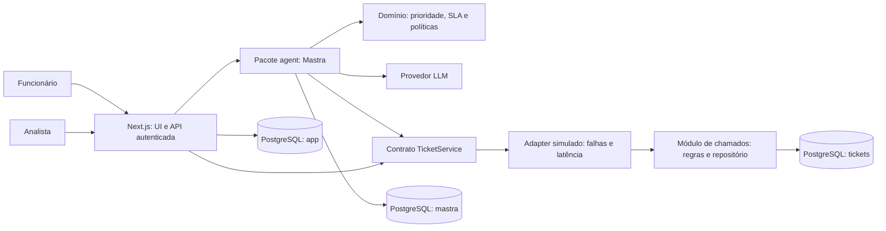

# Arquitetura e tecnologias

> Levantamento inicial: decis?es de implementa??o foram atualizadas. Consulte o [README execut?vel](../README.md) e o [ADR FastAPI](09-arquitetura-fastapi.md) para a arquitetura vigente.


## Decisão de arquitetura

Usar uma aplicação TypeScript com **Next.js na interface e backend**, Mastra em módulo de servidor e **serviço de chamados simulado como módulo separado dentro do próprio Next.js**. A separação será de responsabilidades e contratos. Interpretamos que isso atende ao PRD, que não exige processos ou APIs HTTP independentes. Essa opção reduz o trabalho de infraestrutura e favorece a entrega rápida solicitada.



Os três cilindros representam schemas na mesma instância PostgreSQL local. O schema `tickets` organiza os dados do módulo; não implica outro serviço de rede nem isolamento físico. O agente importa somente o contrato/fachada autorizada, sem acesso direto ao repositório. Todos esses módulos executam no servidor Next.js.

“Simulado” significa representar o sistema legado com dados fictícios e falhas controladas. As operações são funcionais e persistidas no PostgreSQL; uma lista fixa em memória perderia alterações no reinício e não atenderia à persistência exigida.

Não criar um terceiro servidor apenas para hospedar Mastra: a integração oficial permite chamar o agente em rotas Next.js. O módulo permanece independente da UI. [Integração oficial](https://mastra.ai/integrations/frameworks/next-js).

## Stack proposta

| Tecnologia | Uso e justificativa | Alternativa/trade-off |
| --- | --- | --- |
| Node.js 24 | Runtime do servidor Next.js e módulos; compatível com requisitos declarados consultados | Fixar versão de imagem e validar build real |
| Next.js App Router + React | Cinco telas, sessão, rotas de API e streaming num ponto de entrada | Chamados em módulo de servidor, separado do agente |
| TypeScript estrito + Zod | Tipos compartilhados e validação de requisições, ferramentas e saídas do modelo | Tipagem estática não valida dados externos sozinha |
| Mastra | Atende preferência do avaliador; agente, ferramentas, workflows e tracing | Não misturar exemplos antigos `v0` com API `v1` |
| PostgreSQL 18 | Transações, estado durável, busca textual e tarefas persistidas | Fixar minor/digest no bootstrap; não usar versão RC |
| Drizzle ORM + `pg` | SQL próximo do domínio; migrations revisáveis; suporte PostgreSQL | Escolher linha estável e consultar documentação dessa linha |
| Tailwind CSS + Radix/shadcn | Construir UI acessível mantendo controle sobre estilo | Componentes padrão precisam ser adaptados às telas |
| Streaming + HTTP | Resposta do agente em stream no POST; SSE para eventos e mensagens humanas | Sem infraestrutura de WebSocket ou fila externa |
| Vitest | Regras, contratos, banco e integração | Casos de domínio têm mais valor que snapshots de componentes triviais |
| Playwright | Jornadas completas de funcionário e analista em contextos separados | Executar com modelo simulado no CI; smoke real separado |
| npm | Gestão de dependências e um lockfile | Uma aplicação não precisa de workspaces/Turborepo agora |
| Docker Compose | Execução reproduzível de Next.js e PostgreSQL, com migrations | Não é orquestrador de produção; suficiente para desafio local |

Mastra oferece `PostgresStore` e schema configurável, permitindo usar o mesmo servidor PostgreSQL com tabelas internas separadas. Não editar essas tabelas pelo ORM de domínio. [Documentação](https://mastra.ai/integrations/databases/postgresql).

Drizzle integra com `pg` e oferece migrations SQL. A página atual de introdução já mostra comandos para RC; **não copiar esses comandos automaticamente** para a versão estável recomendada. [Referência](https://orm.drizzle.team/docs/get-started/postgresql-new).

## Fotografia das versões disponíveis

Consulta ao registro npm em 27/10/2026. Isto é levantamento, **não uma matriz de integração testada** e não substitui o lockfile.

| Pacote | Versão observada | Observação |
| --- | --- | --- |
| `next` | 16.4.3 | Declara Node >=20.9.0 |
| `react` | 19.3.1 | Validar combinação com adaptadores de UI |
| `@mastra/core` | 1.79.0 | Node >=22.13.0; Zod 3.25 ou 4 |
| `@mastra/pg` | 1.32.0 | Peer `@mastra/core >=1.76.0-0 <2.0.0-0` |
| `@mastra/ai-sdk` | 1.11.2 | Somente se adotarmos o protocolo AI SDK UI |
| `@ai-sdk/react` | 4.0.159 | Opcional; validar peer de React e versão do protocolo |
| `ai` | 7.0.155 | Opcional para adaptador UI; evitar dependência sem necessidade |
| `@ai-sdk/google` | 4.0.107 | Candidato a adapter do provedor; validar no spike |
| `drizzle-orm` / `drizzle-kit` | 0.45.4 / 0.31.11 | Linhas estáveis observadas; evitar `@rc` |
| `zod` | 4.6.7 | Validar compatibilidade dos schemas de ferramentas |
| `typescript` | 7.0.2 | Versão observada; não é obrigação usar a mais recente |
| `vitest` | 5.0.5 | Engines consultados incluem Node 24 |
| `@playwright/test` | 1.64.1 | Alinhar biblioteca e imagem de CI |

Proposta inicial: frontend com SSE tipado próprio e componentes próprios. Isso reduz a dependência de compatibilidade entre Mastra, AI SDK UI e peças prontas. Se o adaptador oficial encurtar o spike, podemos adotá-lo, fixando todas as versões juntas. Não manter dois protocolos de chat em paralelo.

## Provedor de IA

**Provedor prioritário:** Google Gemini, conforme preferência informada pelo usuário por possuir créditos. Google Gemini Flash segue como proposta de modelo, com `LLM_MODEL=google/gemini-3.8-flash` como candidato a identificador do Mastra. A documentação do Google apresenta `gemini-3.8-flash` como estável, com function calling e saída estruturada. Isso fundamenta a candidatura, não comprova disponibilidade na conta nem compatibilidade ponta a ponta com o adapter. [Modelo](https://ai.google.dev/gemini-api/docs/models/gemini-3.8-flash), [saída estruturada](https://ai.google.dev/gemini-api/docs/structured-output).

A escolha busca um modelo generalista para português, extração de campos e chamadas de ferramentas. Não afirmamos ser o mais barato ou melhor sem benchmark. O identificador, autenticação, custo e latência serão validados na etapa 0. Para reduzir o prazo, não implementar múltiplos provedores agora; preservar apenas a fronteira de configuração.

Antes de escolher a credencial/adapter, identificar onde estão os créditos e confirmar sua elegibilidade para a API e o projeto usados. Não presumir que créditos informados cobrem automaticamente uma chamada da Gemini API ou do Vertex AI. A configuração de chave listada abaixo é provisória até essa verificação; credenciais devem ser configuradas localmente, sem envio pelo chat.

O contrato de domínio não dependerá do fornecedor. Guardar modelo e versão do prompt por execução. Não habilitar busca web, execução de código ou ferramentas externas do provedor para esse agente: a fonte autorizada é a central de ajuda e o serviço simulado de chamados.

## Estrutura sugerida

```text
src/
  app/                  # Páginas e Route Handlers: login, chat, console e API
  components/           # Componentes de interface
  server/
    agent/              # Mastra, workflow por turno e ferramentas
    tickets/
      contract.ts       # Interface TicketService e DTOs
      service.ts        # Fachada autorizada e regras de chamados
      repository.ts     # Drizzle/PostgreSQL, sem importação pelo agente
      simulator.ts      # Adapter para erros e atrasos controlados
    conversations/      # Estado, mensagens, rascunhos e atendimento humano
    domain/             # Prioridade, SLA e políticas puras
    db/                 # Schema e conexão PostgreSQL
    auth/               # Sessões e autorização
  contracts/            # Zod, DTOs HTTP e eventos de stream
drizzle/                # Migrations revisáveis
tests/
  integration/
  e2e/
  evals/
docs/
compose.yaml
.env.example
package.json
package-lock.json
```

Evitar criar abstrações vazias. O domínio não importa Next.js ou SDK do provedor. Os módulos de servidor usam barreira `server-only`; agente e credenciais nunca entram no bundle do navegador. A ferramenta do Mastra chama a fachada `TicketService` diretamente no servidor, sem HTTP para a própria aplicação. Route Handlers autenticam e validam os pedidos da UI.

## Docker e inicialização

| Serviço | Responsabilidade | Porta pública local |
| --- | --- | --- |
| `postgres` | Banco, volume nomeado e healthcheck | Opcionalmente 5432 vinculada a localhost para desenvolvimento |
| `migrate` | Job único de migrations e seed idempotente, usando a imagem da aplicação | Nenhuma |
| `web` | Next.js: UI, API, agente, módulo de chamados e streaming | 3000 vinculada a localhost |

Dois processos contínuos: Next.js e PostgreSQL. Sem Fastify, API interna, worker ou fila externa na primeira versão. O turno é executado durante a requisição de streaming; registros persistidos permitem identificar interrupção e retentar explicitamente com idempotência. Não iniciar trabalho essencial com promessa solta após enviar a resposta HTTP.

Ordem: PostgreSQL saudável -> migrations concluídas -> web. `depends_on` simples não espera o banco ficar pronto; usar `service_healthy` e `service_completed_successfully`. [Docker Compose](https://docs.docker.com/compose/how-tos/startup-order/).

Meta de uso da aplicação final em PowerShell:

```powershell
Copy-Item .env.example .env
# Preencher a chave do provedor e os segredos locais indicados.
docker compose up --build
```

Esses comandos ainda não rodam a aplicação: `compose.yaml` e serviços serão criados na implementação. A chave de API vem do ambiente de execução; não vai ao Dockerfile, imagem, argumento de build ou variável `NEXT_PUBLIC_*`.

## Configurações previstas

| Variável | Finalidade |
| --- | --- |
| `DATABASE_URL` | Dados da aplicação e chamados, organizados em schemas/módulos |
| `MASTRA_DATABASE_URL` | Persistência interna do Mastra em schema dedicado |
| `MIGRATION_DATABASE_URL` | Credencial de bootstrap/migrations, indisponível ao navegador |
| `SESSION_SECRET` | Proteção da sessão; sem valor real no exemplo |
| `GOOGLE_GENERATIVE_AI_API_KEY` | Chave se usado o adapter Google AI SDK; confirmar nome no spike |
| `LLM_MODEL` | Modelo configurável; candidato `google/gemini-3.8-flash` |
| `LLM_MODE` | `live` ou `stub`; stub identificado explicitamente na UI e README |
| `MAX_USER_TURNS` | 30 |
| `SERVICE_DESK_TIMEZONE` | Premissa inicial `America/Fortaleza` |
| `SERVICE_DESK_OPEN` / `SERVICE_DESK_CLOSE` | 08:00 / 18:00 |
| `TICKET_FAILURE_MODE` | `off` por padrão; cenários determinísticos em teste |
| `LLM_MAX_STEPS` / `LLM_TIMEOUT_MS` | Limites por execução; valores definidos após spike |

Seeds e credenciais ilustrativas são locais. Acesso público com login de senha arbitrária exige limite global de gasto e ambiente isolado de demonstração; isso entra somente no plano opcional de deploy.

## O que não precisamos inicialmente

PostgreSQL consegue atender busca textual e similaridade de um conjunto de 5-10 artigos; começar com busca lexical e metadados, usando `pg_trgm` se necessário. [Referência PostgreSQL](https://www.postgresql.org/docs/current/pgtrgm.html).

Não há necessidade inicial de banco vetorial, embeddings, Elasticsearch, Kubernetes, Redis, plataforma externa de tracing ou framework de múltiplos agentes. Adicionar algo apenas se uma falha concreta dos cenários justificar.

Se futuramente precisarmos extrair o legado para outro processo, implementar um adapter HTTP para `TicketService`. Não manter essa infraestrutura antecipadamente na entrega inicial.
