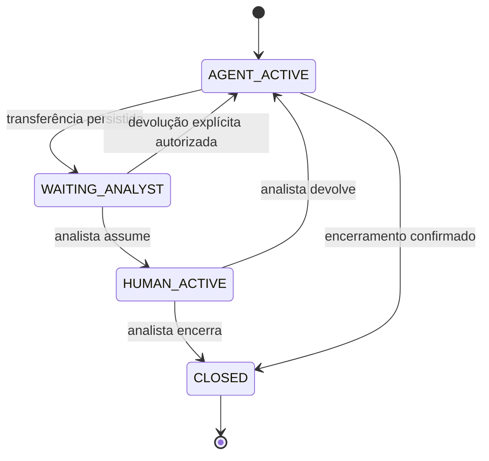

# Estratégia do agente e regras de execução

> Levantamento inicial: decis?es de implementa??o foram atualizadas. Consulte o [README execut?vel](../README.md) e o [ADR FastAPI](09-arquitetura-fastapi.md) para a arquitetura vigente.


## Princípio de implementação

O LLM interpreta linguagem e propõe ações; código de domínio controla autorização, SLA, confirmação, idempotência, limites e transições. Não concentrar todas as regras num prompt e assumir que o modelo irá respeitá-las.

Usar um agente Mastra de atendimento, com ferramentas tipadas, dentro de um workflow por turno. Não precisamos de uma equipe de agentes autônomos. Separar extração, evidências, política e resposta torna a decisão testável sem multiplicar chamadas ao modelo.

## Fluxo por mensagem

1. Autenticar usuário e autorizar a conversa. Obter identidade da sessão, nunca do texto do pedido.
2. Em transação, validar estado e limite; deduplicar `clientMessageId`; persistir mensagem e registro de execução do turno.
3. O handler de streaming obtém lease exclusivo por conversa e executa o turno durante a requisição. Se estiver aguardando analista, em atendimento humano ou encerrada, não inicia o agente.
4. Carregar resumo estruturado, mensagens recentes, rascunho e contexto confirmado. Manter fatos desconhecidos como desconhecidos.
5. Interpretar intenção e extrair fatos com schema validado: dúvida, consulta, complemento, abertura, humano, fora do escopo ou ambíguo.
6. Consultar ferramentas necessárias: chamados do usuário e artigos aplicáveis. Leituras independentes podem ocorrer juntas; efeitos não.
7. Aplicar regras de domínio e registrar regra acionada, evidências e grau de segurança. Se faltar informação, fazer pergunta objetiva com opções rápidas.
8. Produzir resposta, seleção de chamados ou rascunho; streaming de ações reflete execução real. Para uma mutação, aguardar confirmação por endpoint próprio.
9. Persistir resposta final, decisão, eventos, métricas e resultado. Publicar `message.completed` somente quando persistido.
10. Ao confirmar rascunho, revalidar dono, versão do chamado, estado da conversa, duplicidade e SLA; executar operação idempotente pelo contrato `TicketService`, no mesmo servidor Next.js.

Mastra oferece suspensão/retomada com snapshots persistidos. Podemos usá-la para etapas de workflow se simplificar a integração; **não é necessário manter uma execução de LLM aberta enquanto o usuário confirma ou aguarda humano**. Rascunhos e propriedade da conversa pertencem ao domínio persistido. [Mastra: suspensão e retomada](https://mastra.ai/docs/workflows/suspend-and-resume).

## Ferramentas e limites

| Ferramenta | Entrada controlada | Saída | Efeito |
| --- | --- | --- | --- |
| `searchKnowledge` | Consulta, categoria, sistema operacional conhecido | Artigos, trechos, IDs, aplicabilidade e score de busca | Leitura |
| `listMyTickets` | Filtros de estado/problema; identidade fora dos argumentos do modelo | Chamados pertencentes ao solicitante | Leitura |
| `getMyTicket` | ID/protocolo | Chamado autorizado e versão | Leitura |
| `findRelatedTickets` | Sintomas, ativo, período, categoria | Candidatos do mesmo solicitante e motivos de semelhança | Leitura |
| `calculatePriorityAndSla` | Impacto, urgência, alternativa e instante do relógio | Prioridade, prazo, regra e justificativa | Cálculo determinístico |
| `prepareTicketDraft` | Dados propostos, alvo opcional, evidências | Rascunho persistido e versão | Não altera chamado |
| `requestHumanHandoff` | Motivo permitido, evidências e resumo | Estado da transferência | Altera conversa, sem criação implícita de chamado |

Criação, atualização e reabertura são **comandos do serviço de aplicação após confirmação**, não ferramentas de escrita disponíveis livremente ao modelo. Isso preserva a preferência por Mastra sem permitir que uma chamada incorreta pule a confirmação.

O modelo não escolhe `requesterId`, papel, proprietário da conversa ou identidade do analista. Não recebe conexão SQL, ferramentas de navegação ou execução de código.

## Matriz de decisão

| Situação | Comportamento |
| --- | --- |
| Fora de TI | Redirecionar com clareza; sem chamado de TI |
| Pedido explícito de analista | Transferir com contexto disponível, sem exigir triagem completa |
| Falha parando equipe/empresa | Crítica; transferir; eventual criação continua exigindo confirmação |
| Chamado consultado vencido | Informar atraso e transferir conforme interpretação conservadora do Anexo A; divergência visual registrada em D-04 |
| Evidência insuficiente para ação segura | Pergunta de esclarecimento quando útil; se continua inseguro, transferir |
| Dúvida respondida por artigo aplicável | Responder com fonte; oferecer continuidade se não resolver |
| Artigo VPN 809 para Windows 10, usuário Windows 11 | Não recomendar procedimento incompatível; preparar atendimento/chamado |
| Sistema operacional desconhecido, artigo restrito | Perguntar qual o sistema; não presumir a partir da tela ilustrativa |
| Vários chamados plausíveis | Mostrar seleção; não decidir apenas pelo primeiro retorno |
| Mesmo problema em chamado aberto | Propor complemento nesse chamado; confirmar antes de atualizar |
| Mesmo problema resolvido há até 7 dias | Propor reabertura, com confirmação |
| Sem chamado correspondente | Coletar campos, prioridade e rascunho; aguardar confirmação |
| Serviço de chamados simula indisponibilidade | Informar falha; preservar contexto; não afirmar consulta/criação bem-sucedida |
| Conversa aguardando analista ou com analista | Persistir mensagem do usuário para atendimento humano, sem nova chamada ao LLM |

Não usar confiança baixa como substituta de uma pergunta simples. Ao mesmo tempo, não insistir em perguntas quando o usuário já pediu um humano.

## Prioridade e SLA por código

Precedência proposta: crítica > alta > média > baixa. Perguntar impacto e urgência quando desconhecidos; ausência de resposta não significa prioridade baixa. Se fatos se contradizem, esclarecer ou transferir.

Premissas iniciais, explicitadas porque o Anexo A não define todos os detalhes:

- Segunda a sexta, 08:00-18:00, fuso `America/Fortaleza`, sem feriados na primeira versão.
- Crítica: 60 minutos corridos, plantão 24h.
- Alta: 240 minutos úteis.
- Média: 30 horas úteis, interpretando 3 dias úteis como três jornadas de 10h.
- Baixa: 50 horas úteis, interpretando 5 dias úteis como cinco jornadas de 10h.
- Criação ancora o prazo da primeira resposta. Primeira resposta e atualizações substantivas do suporte ancoram o próximo prazo.
- Mensagem do funcionário, evento de transferência e resposta automática do bot não renovam o prazo. Guardar `updatedAt` técnico separado de `lastSupportUpdateAt`.
- Para estado resolvido/fechado, não há contagem ativa de atraso; reabertura inicia novo ciclo preservando o anterior.
- `now > nextResponseDueAt` significa vencido. Na igualdade exata, ainda no prazo.
- Janela para reabrir: `resolvedAt <= now` e `now - resolvedAt <= 7 * 24h`; confirmar semântica de dias corridos em D-05.

Exemplos de teste com relógio fixo e calendário acima:

| Caso | Início | Resultado esperado |
| --- | --- | --- |
| Crítica | Sex. 23/10/2026 23:30 | Sáb. 24/10 00:30 |
| Alta | Sex. 23/10/2026 17:00 | Seg. 26/10 11:00 |
| Média | Sex. 23/10/2026 17:00 | Qua. 28/10 17:00 |
| Baixa | Sex. 23/10/2026 17:00 | Sex. 30/10 17:00 |
| Alta fora do expediente | Sáb. 24/10/2026 10:00 | Seg. 26/10 12:00 |

A frase ilustrativa “a resposta chega antes das 14h” só pode aparecer se o prazo calculado permitir. Alta prioridade não garante atendimento antes de toda reunião marcada para o mesmo dia. Nunca prometer resolução pelo prazo de primeira resposta.

## Duplicidade e confirmação

Buscar candidatos apenas do mesmo solicitante: categoria e ativo ajudam, mas similaridade do título sozinha não prova que é o mesmo problema. Mostrar o candidato e confirmar o vínculo quando houver dúvida.

Cada rascunho tem `operation`, `targetTicketId`, `targetVersion`, `payload`, `revision`, `status` e `expiresAt`. Confirmação deve apontar para esse ID e revisão; não aceitar `confirmed: true` gerado pelo modelo.

Ao confirmar:

1. Revalidar sessão, escopo e revisão do rascunho.
2. Verificar se está pendente; confirmação repetida retorna o resultado anterior.
3. Reconsultar correspondências/versão. Se um novo chamado equivalente apareceu, invalidar o rascunho e apresentar atualização para nova confirmação.
4. Usar chave de idempotência derivada da operação aprovada. O serviço de chamados guarda chave, hash do payload e resposta na mesma transação da alteração, mesmo sendo chamado como função local.
5. Em timeout após envio, repetir com a mesma chave ou consultar resultado. Nunca trocar a chave para “tentar de novo”.

## Transferência e concorrência



Somente `AGENT_ACTIVE` permite execução automática. “Aguardando atendente” também pausa, mesmo sem um analista ter assumido. Não retomar por expiração de relógio ou perda da conexão do analista.

Mudança de estado usa atualização condicional/lock, `stateVersion` e incremento de `generationEpoch`. Antes de publicar tokens, persistir resposta final ou executar efeito, verificar que o epoch ainda é o mesmo. Transferência/assunção cancela execução em andamento; o stream fecha a geração. Conteúdo já transmitido antes da transição permanece histórico, sem novos tokens posteriores à pausa.

Resumo de transferência: pedido do funcionário, sintomas, artigo consultado e restrições, chamado relacionado, prioridade e prazo, informações coletadas/faltantes, ações já concluídas, motivo da transferência. Não inventar analista disponível, fila N2 ou promessa de 2h.

Pausa e resumo são persistidos antes da tentativa de atualizar o legado simulado. Se o adapter lançar erro, manter a conversa segura na fila humana e registrar a operação do chamado como pendente. O console distingue pausa/encaminhamento da conversa de atualização do chamado ainda não concluída. Retentativas limitadas ocorrem na requisição; se esgotarem, oferecer ação explícita de tentar novamente, com a mesma chave idempotente. Não depender de worker ou temporizador em memória.

Dois analistas disputando atendimento: `UPDATE ... WHERE state = WAITING_ANALYST AND analyst_id IS NULL` com versão. Um vence; o outro recebe `409`. Devolução e encerramento só pelo proprietário atual, ou por política explícita de supervisão futura.

## Transparência das decisões

Cada turno produz uma decisão estruturada, ligada à resposta. A UI resume as ações acima da mensagem e expande o detalhe. Exibir justificativa objetiva e evidências verificáveis, sem solicitar raciocínio interno privado do modelo.

Exemplo de contrato, não resultado de execução já realizada:

```json
{
  "intent": "create_ticket",
  "facts": { "os": "Windows 11", "vpnError": "809", "affectedScope": "individual" },
  "missingFields": ["workBlocked", "sameDayCommitment"],
  "confidence": { "value": 0.86, "source": "model_self_report", "calibrated": false },
  "rulesApplied": ["KB_APPLICABILITY", "REQUIRE_IMPACT_URGENCY"],
  "evidence": [{ "kind": "article", "id": "kb-vpn-809", "result": "not_applicable" }],
  "actions": [{ "name": "searchKnowledge", "status": "succeeded" }],
  "nextAction": "ask_clarification",
  "rationale": "O artigo vale para Windows 10. Falta esclarecer urgência para classificar o chamado.",
  "promptVersion": "triage-v1"
}
```

Separar `confidence` do score de busca. Uma confiança autodeclarada de 86% não representa probabilidade comprovada de acerto. Mostrar “segurança estimada” e origem; regras determinísticas mostram “regra aplicada”. Proposta inicial de triagem: abaixo de 0,75 exige esclarecimento ou humano; o valor é heurístico e será ajustado por cenários, nunca usado para dispensar validações.

Registrar sucesso, falha e tentativa de ferramenta com horários, latência e IDs autorizados. O servidor monta os chips a partir desses eventos, e não de frases livres do modelo. Erros não geram chip “criou chamado”. Logs técnicos completos ficam fora da interface do funcionário e sem segredos.

## Resiliência, consumo e avaliação

- Leituras: até três tentativas totais em falhas transitórias, backoff com jitter e timeout por tentativa; não repetir 4xx de autorização/validação.
- Escritas: retentativa apenas com chave idempotente, consulta de resultado e verificação de versão.
- Simulador: falhar as primeiras N chamadas por cenário, introduzir atraso controlado e simular timeout depois de commit. Não usar aleatoriedade nos testes.
- LLM: teto inicial proposto de quatro passos de ferramentas por turno; limitar tokens/contexto e duração. Ao esgotar, explicar e encaminhar, sem loop ilimitado.
- Recuperação: execução com lease expirado é exibida como interrompida; retomada explícita revalida estado e consulta operação idempotente antes de repetir efeitos. Nunca presumir que execução interrompida não alterou nada. Não prometer retomada automática em segundo plano nesta versão.
- Guardar fatos estruturados e resumo durável; usar apenas histórico relevante na próxima chamada.
- Medir tokens de entrada/saída quando fornecidos pelo adapter, latência, tentativas, ferramentas e resultado final. Preço por token é configuração versionada; ausência de preço gera “custo indisponível”, não zero.
- Validar por cenários determinísticos e executar uma pequena avaliação real do modelo. Uma segunda chamada de LLM para julgar toda resposta não é requisito inicial.
